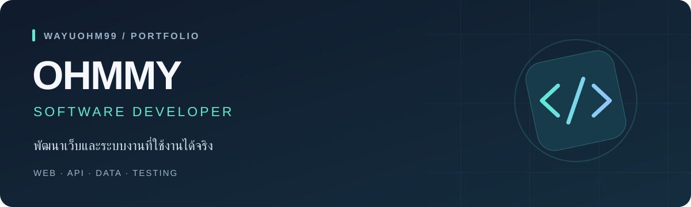

  

  <strong>สวัสดีครับ ผมโอมมี่</strong> 
  พัฒนาเว็บแอปพลิเคชัน ตั้งแต่หน้าจอและ API ไปจนถึงข้อมูล การทดสอบ และเอกสาร 
  สนใจการเปลี่ยนปัญหาหน้างานให้เป็นระบบที่ใช้งานง่ายและตรวจสอบได้

  <a href="#ผลงานเด่น">ผลงานเด่น</a> &nbsp; / &nbsp;
  <a href="#โครงงานอื่น">โครงงานอื่น</a> &nbsp; / &nbsp;
  <a href="#เครื่องมือที่ใช้">เครื่องมือที่ใช้</a> &nbsp; / &nbsp;
  <a href="https://github.com/WayuOHm99/suth-helpdesk-assets-portfolio/blob/main/docs/portfolio/README.md">กรณีศึกษา</a>

---

## ผลงานเด่น

INTERNSHIP PROJECT · 8 มิถุนายน–12 ตุลาคม 2026

### SUTH Helpdesk Assets

**ระบบบริหารทรัพย์สิน IT และงานพิมพ์ของโรงพยาบาล**

ช่วยเจ้าหน้าที่ IT จัดการเครื่องพิมพ์ สัญญา ยอดพิมพ์รายเดือน และรายงานค่าใช้จ่ายในระบบเดียว

ภาพหน้าเข้าสู่ระบบไม่มีข้อมูลบัญชีจริง ส่วนภาพภายในระบบใน Repo ใช้ข้อมูลจำลอง

**บทบาทของผม** — รับผิดชอบการพัฒนาระบบครบวงจรภายใต้การดูแลของพี่เลี้ยง ตั้งแต่หน้าเว็บและ API การทดสอบ เอกสาร ไปจนถึงการส่งมอบ โดยคงเครดิตผู้ร่วมพัฒนาจากโครงการต้นทาง

- **ข้อมูลที่ตรวจสอบได้:** ดูแผนการนำเข้า Excel/CSV ก่อนยืนยัน และรองรับ CSV ภาษาไทย
- **รายงานที่สอดคล้องกัน:** ใช้ตัวกรองชุดเดียวกับ Dashboard ตาราง และไฟล์ส่งออก
- **การทดสอบตามความเสี่ยง:** ครอบคลุมกฎธุรกิจ การใช้งานผ่านเบราว์เซอร์ และการเข้าถึงหน้าเว็บ พร้อมระบุข้อจำกัดในกรณีศึกษา

`Vue 3` `Express` `MySQL` `TanStack Query` `Playwright`

**[สำรวจโครงการ ↗](https://github.com/WayuOHm99/suth-helpdesk-assets-portfolio)** &nbsp; · &nbsp; **[อ่านกรณีศึกษา 5 งาน ↗](https://github.com/WayuOHm99/suth-helpdesk-assets-portfolio/blob/main/docs/portfolio/README.md)**

---

## โครงงานอื่น

### 01 &nbsp; RubricLens AI

**ผู้ช่วยวิเคราะห์รายงานภาษาไทยตามเกณฑ์ประเมิน** — ใช้ AI วิเคราะห์พร้อมหลักฐานประกอบและคำแนะนำ โดยคำนวณคะแนนรวมด้วยโค้ด

`React` `TypeScript` `Cloudflare Workers` `Gemini`

[ดูโค้ด ↗](https://github.com/WayuOHm99/rubriclens-ai) &nbsp; · &nbsp; [เปิดเว็บสาธิต ↗](https://rubriclensai.pages.dev/)

### 02 &nbsp; EQ-BANK

**ระบบให้คะแนนกิจกรรมค่าย** — รองรับทีมงานหลายคนและการใช้งานบนมือถือ แสดงอันดับแบบเรียลไทม์ พร้อมประวัติการให้คะแนน

`Next.js` `Supabase` `PostgreSQL` `Playwright`

[ดูโค้ด ↗](https://github.com/WayuOHm99/CAMPBANK) &nbsp; · &nbsp; [เปิดเว็บสาธิต ↗](https://campbank-fawn.vercel.app)

### 03 &nbsp; Run Performance Project

**Dashboard ติดตามการฝึกซ้อม** — รวบรวมข้อมูลการออกกำลังกายจาก Garmin เพื่อดูความก้าวหน้าและการฟื้นตัวของนักกีฬา

`Python` `Streamlit` `SQLite` `Plotly`

[ดูโค้ด ↗](https://github.com/WayuOHm99/Run-Performance-Project)

---

## เครื่องมือที่ใช้

| งาน | เทคโนโลยีที่ใช้ในโครงงาน |
| :--- | :--- |
| **หน้าเว็บ** | Vue 3 · React · Next.js · Tailwind CSS · Streamlit |
| **API และข้อมูล** | Node.js · Express · MySQL · PostgreSQL · SQLite · Supabase |
| **ภาษา** | JavaScript · TypeScript · Python · SQL |
| **ทดสอบและส่งมอบ** | Git · Playwright · Vitest · Docker · Cloudflare Workers · Vercel |

## วิธีทำงานของผม

**เข้าใจปัญหา → กำหนดขอบเขต → พัฒนา → ตรวจสอบ → ส่งมอบ**

เริ่มจากสิ่งที่ผู้ใช้ต้องทำจริง เลือกการทดสอบให้เหมาะกับความเสี่ยง และบันทึกเหตุผลของการตัดสินใจเพื่อให้พัฒนาต่อได้ ใช้ AI ช่วยพัฒนาโดยตรวจสอบโค้ดและผลลัพธ์ก่อนนำไปใช้

  ดูรายละเอียดการออกแบบ หลักฐานการทดสอบ และข้อจำกัดได้ในเอกสารของแต่ละโครงการ

